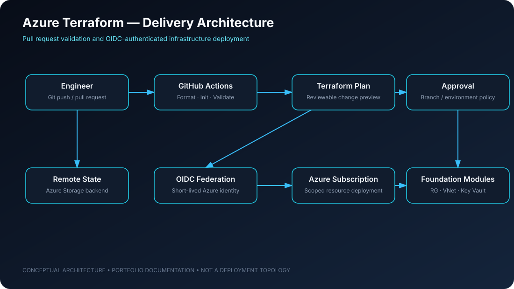

# Azure Terraform & GitHub Actions CI/CD Infrastructure Platform

### Repeatable Azure infrastructure provisioning with Terraform and federated CI/CD identity

**Engineering focus:** Infrastructure as Code · Environment isolation · Federated identity · Automated validation

---

## 01 — Project overview

This repository contains a modular Infrastructure as Code (IaC) framework for provisioning selected Azure foundation resources with Terraform and automating validation and deployment workflows using GitHub Actions.

The repository is structured around reusable modules for:

- Azure Resource Groups
- Virtual Networks and subnets
- Azure Key Vault

It separates development and production environment configurations and uses GitHub Actions with Azure OpenID Connect (OIDC) federated credentials for passwordless workflow authentication.

> **Scope and status:** This is a portfolio/reference implementation. The presence of a production environment directory or an apply workflow does not establish that production infrastructure is deployed, independently reviewed, or operating for a live workload. Review and test all configuration in a non-production subscription before use.

## 02 — Architecture and workflow

~~~mermaid
flowchart LR
    DEV["Engineer"] --> PR["Pull request"]
    PR --> GHA["GitHub Actions"]
    GHA --> FMT["Format / Init / Validate"]
    FMT --> PLAN["Terraform Plan"]
    PLAN --> REVIEW["Review plan"]
    REVIEW --> MERGE["Merge to main"]
    MERGE --> APPLY["Terraform Apply workflow"]
    APPLY --> OIDC["Azure OIDC federated identity"]
    OIDC --> AZ["Azure subscription"]
    AZ --> RG["Resource Group"]
    RG --> VNET["Virtual Network / Subnets"]
    RG --> KV["Key Vault"]
    STATE[("Remote Terraform state")] --- PLAN
    STATE --- APPLY
~~~

### Pull request path

1. A change is proposed through a pull request.
2. GitHub Actions runs Terraform formatting, initialization and validation.
3. Terraform generates a plan for review.
4. The plan is reviewed before changes are merged.

### Main branch path

The repository workflow describes an apply path on changes pushed to the main branch. Before enabling this for a real environment, configure branch protection, environment approvals, restricted OIDC trust conditions and state locking.

## 03 — Repository structure

~~~text
.
├── .github/
│   └── workflows/
│       └── terraform-pipeline.yml
├── modules/
│   ├── resource_group/
│   ├── vnet/
│   └── key_vault/
├── environments/
│   ├── dev/
│   └── prod/
└── README.md
~~~

## 04 — Technology and design choices

| Area | Implementation |
|---|---|
| Cloud platform | Microsoft Azure |
| IaC | Terraform (>= 1.8.0, per project prerequisites) |
| Workflow orchestration | GitHub Actions |
| Authentication | Azure federated credentials using OIDC |
| Reusable components | Resource Group, VNet, Key Vault modules |
| Environment separation | Dev and prod configuration directories |
| State | Azure Storage remote backend configuration |

### Why OIDC?

OIDC allows GitHub Actions to obtain short-lived Azure access through a federated identity trust. It avoids storing a long-lived Azure client secret in GitHub repository secrets. The trust relationship must be scoped carefully to the expected repository, branch or GitHub environment.

## 05 — Prerequisites

- Terraform >= 1.8.0
- An Azure subscription and permissions to create the configured resources
- An Azure application/service principal configured for federated identity
- GitHub repository variables or secrets for:
  - AZURE_CLIENT_ID
  - AZURE_TENANT_ID
  - AZURE_SUBSCRIPTION_ID
- Azure Storage account and containers matching the remote backend configuration
- Appropriate state access permissions and state locking configuration

Do not store credentials in Terraform variable files or commit real environment secrets.

## 06 — Local workflow

~~~bash
git clone https://github.com/alimulfazalnabil/azure-terraform-cicd-foundation.git
cd azure-terraform-cicd-foundation

cd environments/dev
terraform init
terraform fmt -check
terraform validate
terraform plan
~~~

Review the plan carefully before applying. A local apply should only be performed in a subscription and environment you are authorised to modify.

~~~bash
# Apply only after reviewing the plan and confirming the target subscription.
terraform apply
~~~

## 07 — Security and operational guardrails

The sample configuration should be reviewed against the requirements of the target organisation before reuse.

- Restrict OIDC federated credentials to the intended repository and branch/environment.
- Protect the default branch and require reviews for infrastructure changes.
- Use remote state with encryption, access controls, versioning and locking.
- Keep state files and generated plan files out of source control.
- Review Key Vault soft-delete and purge-protection settings against organisational policy.
- Apply least-privilege Azure RBAC.
- Separate non-production and production subscriptions or scopes where appropriate.
- Require approval gates for production changes.
- Pin and review Terraform provider versions.

**Configuration note:** The current project README records a seven-day Key Vault soft-delete retention and purge protection disabled in its sample configuration. This is a sample setting, not a universal security recommendation; assess and change it to meet the target environment's policy.

## 08 — Validation checklist

| Check | Expected evidence |
|---|---|
| Formatting | terraform fmt succeeds |
| Static validation | terraform validate succeeds |
| Plan review | Plan output reviewed by a maintainer |
| Identity | OIDC trust restricted to intended GitHub context |
| State | Remote backend configured and protected |
| Environment safety | Dev and prod targets are explicitly separated |
| Change control | Protected branch and approval policy configured |

## 09 — Roadmap

- [ ] Add a documented plan artifact and review workflow.
- [ ] Add environment approval gates for production apply.
- [ ] Add policy-as-code checks for Azure resource configuration.
- [ ] Add security scanning and dependency update automation.
- [ ] Add deployment evidence and tested module examples.
- [ ] Document state recovery and environment teardown procedures.

## Maintainer

**Alimul Fazal Nabil** — Cloud AI Platform Engineering | Azure | Terraform | DevOps

[GitHub](https://github.com/alimulfazalnabil) · [LinkedIn](https://www.linkedin.com/in/alimul-fazal-nabil/) · [Portfolio](https://alimulfazalnabil.github.io/)

---

*Portfolio/reference implementation. Validate configuration, access boundaries and policy controls before applying it to shared or production subscriptions.*
